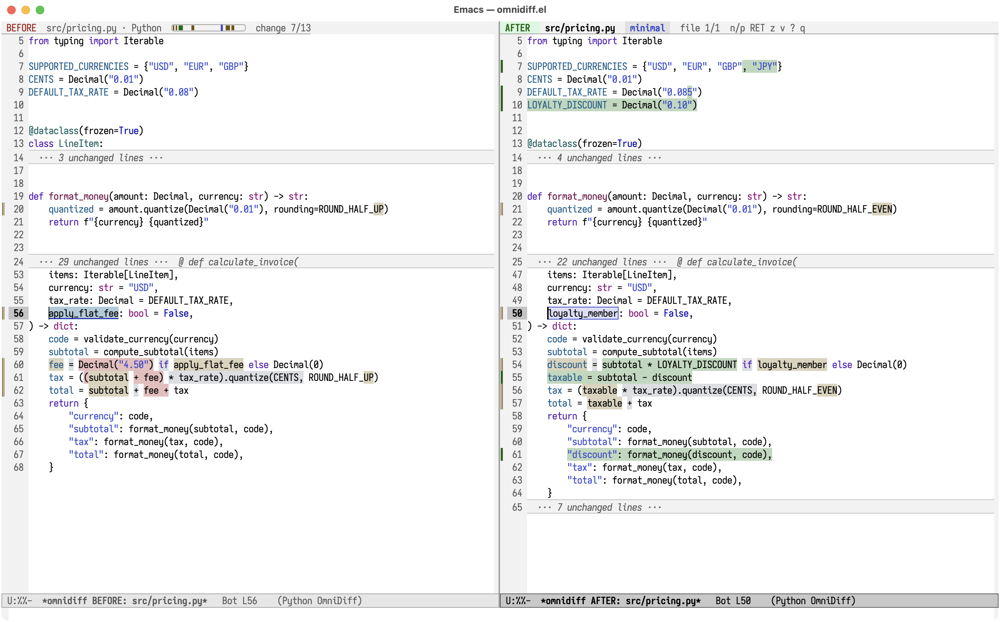
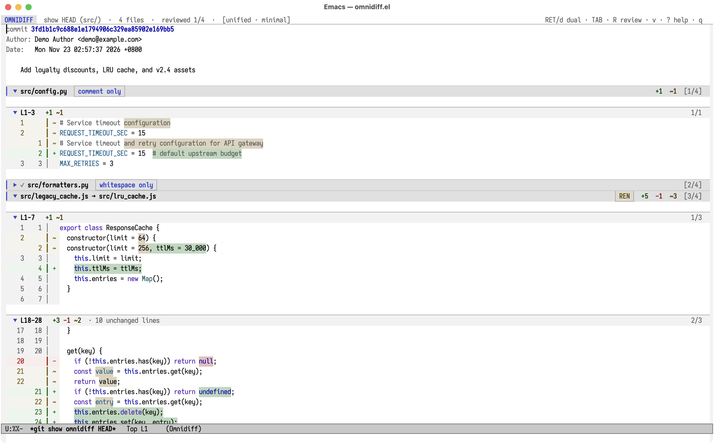
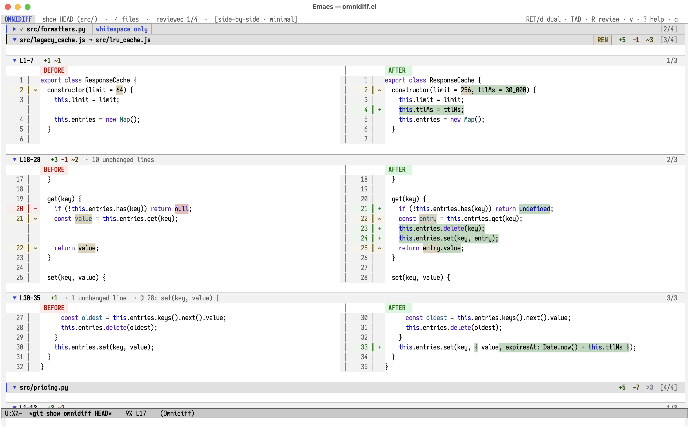
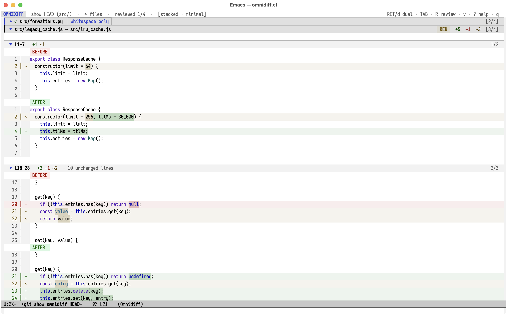
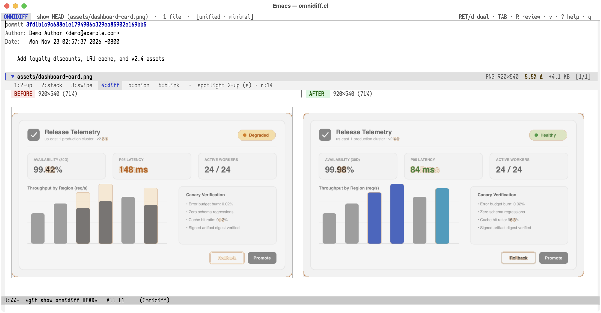
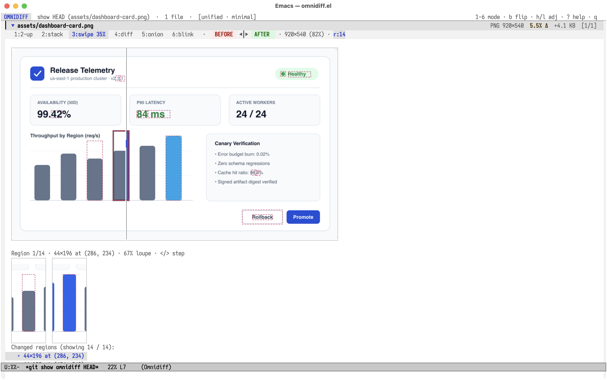
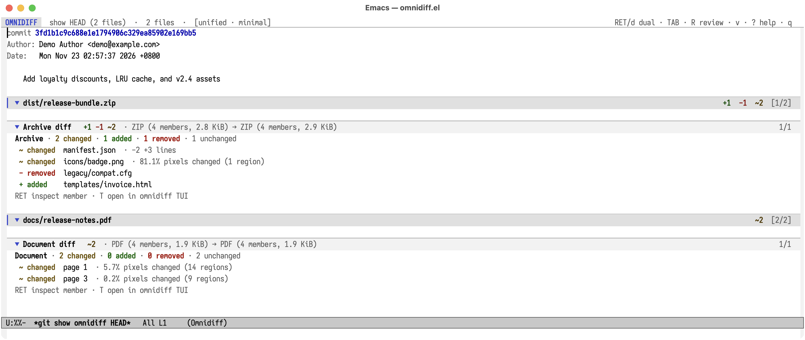
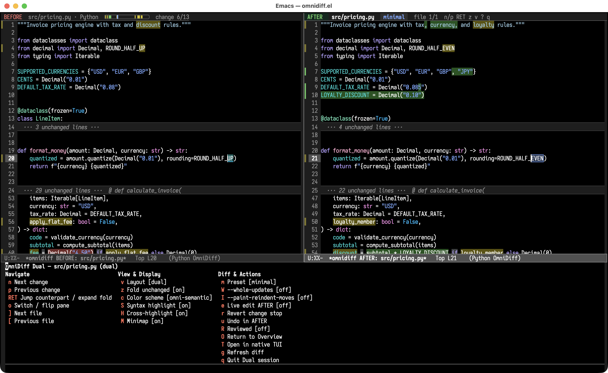

# omnidiff.el

Native Emacs semantic and content-aware diffing backed by upstream [`omnidiff`](https://github.com/ivankovic/omnidiff) (`--mode json`), bringing OmniDiff's signature **"Only What Changed"** experience natively to Emacs — across Git diffs, arbitrary files, live buffers, raster/SVG images, archives, PDFs, fonts, cursors, and message catalogs.



## Features

### Dual Semantic Source Viewer
Compare real source buffers side by side with native Emacs `major-mode` / Tree-sitter syntax highlighting and zero synthetic padding lines — opened directly via `omnidiff-files`, `omnidiff-buffers`, `omnidiff-buffer-vs-head`, `omnidiff-magit-dual`, `d` from Overview, or automatically on single-file Git diffs (`omnidiff-single-file-entry` = `'auto`):

- **Token-only semantic overlays**: unchanged code keeps pure native syntax highlighting while only changed tokens (`insert`, `delete`, `update`, `move`) receive subtle theme-adapted tints.
- **Change stepping & counterpart linking**: step in merged reading order across both panes (`n`/`p`) with an active focus box and vivid opposite-pane cross-highlighting (`H`); press `RET` or `TAB` to jump to an exact `move_target` or paired counterpart (press again to bounce back), and `o` to switch panes or flip sides in `single` layout.
- **Header-line minimap & accessible fringe bars**: clickable cached SVG (GUI) / Unicode block (TTY) change-distribution minimap (`M`) showing your cursor position, unified active/inactive pane headers with smart path truncation, and distinct left-fringe patterns per operation (`insert`/`delete`/`update`/`move`) in graphical frames (`omnidiff-dual-show-fringe`).
- **Context folding with scope breadcrumbs (`z`)**: collapse unchanged line runs into clickable inline fold banners displaying `@ <enclosing declaration>` breadcrumbs; folds expand automatically on click, `RET`/`TAB`, change jumps, or `isearch`.
- **Live worktree editing (`e`) & change-stop revert (`r`/`u`)**: unlock editable AFTER files or live buffers into `omnidiff-dual-edit-mode` (without shadowing normal editing keys) and recompute semantic overlays asynchronously on save (`on-save`, default) or after typing pauses (`idle`), or atomically revert individual semantic change stops (`r`) and undo (`u`).
- **Flexible layouts & synced review workflow**: cycle `auto` / `dual` / `single` pane layouts (`v`), step across files (`]`/`[` or `N`/`P`), mark files reviewed (`R`, synced with Overview), jump back to Overview (`O`), or open sessions in a new `tab-bar` tab (`omnidiff-dual-window-setup`).

### Syntax-Highlighted Multi-File Overview
Powered by a parallelized `--mode json` worker pipeline (`omnidiff-max-parallel`), Overview buffers render multi-file Git diffs with native Emacs `font-lock` syntax highlighting:

- **Three instant in-memory layouts (`v`)**:
  - `unified`: interleaved single-column diff with shared context shown once
  - `side-by-side`: pixel-aligned (GUI) / column-aligned (TTY) two-column `BEFORE | AFTER` layout with CJK width handling, automatic window-resize reflow (preserving folds and cursor), and narrow-window fallback
  - `stacked`: full `BEFORE` block followed by `AFTER` block per hunk
- **Three highlight styles (`H`)**: cycle `token` ("Only What Changed", default), `subtle-line` (gentle line tint + token highlights), and `traditional` (classic full-line wash + inline refine spans) in memory.
- **Semantic summary badges, reviewed checklist (`R`) & trivial-file folding (`F`)**: file headers display semantic badges (`whitespace only`, `comment only`, `moved only`, `new file`, `deleted file`, `no changes`), renamed file indicators (`REN`), and synced reviewed checkmarks (`✓`); press `F` to fold/unfold trivial files, or let large diffs open as a scannable folded checklist (`omnidiff-overview-auto-fold-threshold`).
- **0ms Dual switching (`d` / `RET`)**: press `d` on any text file card (or `RET` on a file header) to open it immediately in the Dual viewer from cached JSON and decoded sources, landing at the line under point.
- **Structured navigation & verbosity controls**: collapsible file cards and hunk headers (`TAB`/`S-TAB`), hunk (`n`/`p`) and file (`]`/`[` or `N`/`P`) jumps, sticky file orientation in the header line, jump-to-source (`RET`), verbosity presets (`m`: `minimal` / `full` / `default`), and CLI semantic flags (`W` for `--whole-updates`, `I` for `--paint-reindent-moves`).

**Unified (`v`) — `token` highlight style (`H`), semantic badges & reviewed progress (`R`)**



**Side-by-side (`v`) — pixel-aligned two-column `BEFORE | AFTER` layout with scope breadcrumbs**



**Stacked (`v`) — sequential `BEFORE` / `AFTER` blocks with `subtle-line` highlight style (`H`)**



### Visual Image Diffing
Inline raster image comparison (`PNG`, `JPEG`, `GIF`, `WebP`, `TIFF`, `BMP`, `ICO`, `HEIC`, etc.) plus collapsible visual previews above `.svg` XML diffs (with Git LFS smudging support):

- **Swipe (`3`)**: zero-redecode `(slice ...)` split curtain with region auto-aim, mouse click/drag, full `0%–100%` travel, and zero-offset dual-contrast divider.
- **2-up Side-by-Side (`1`) & Stacked (`2`)**: top-aligned panes, full-height divider, compact small-image spacing, shared moderate scale, and narrow-window fallback.
- **Spotlight & Pixel Diff (`4`, cycle style with `s`)**: side-by-side **Spotlight** (`spotlight-sbs`, default) desaturates unchanged context while keeping changed pixels crisp with a warm-amber tint and 1px outer contour; press `s` to cycle through single-pane Spotlight, classic ImageMagick pixel mask (with adjustable `-fuzz`), and built-in alpha-aware `librsvg` RGB+α delta preview (with adjustable gain).
- **Onion Skin (`5`) & Blink (`6`)**: alpha-correct compositing with bounded descriptor reuse, and uniform-canvas `BEFORE`/`AFTER` flip (`b`) with non-destructive `DEL` peek return.
- **Inspection tools**: changed-region visual overlay + 1:1 crop loupe (`r`, `<`/`>`), transparent backdrop cycling (`t`), zoom (`+`/`-`/`0`), exact revision blob viewing (`RET`/`o`), external viewer (`x`), responsive window-resize reflow, compact pixel-identical cards, deferred loading (`L`/`C-u L`), and sub-character TTY delta cards.

**Side-by-side Spotlight (`4`) — desaturated context with highlighted changed regions**



**Swipe Curtain (`3`) + Changed-Region Overlay & 1:1 Crop Loupe (`r`)**



### Container & Non-Text Content Diffing
Structured member-level diff cards rendered directly from `--mode json`:

- **Archives** (`ZIP`, `JAR`, `DOCX`, `EPUB`, `TAR`, `.gz`, `.bz2`, `.xz`/`.lzma`): lists changed, added, and removed members with text/picture/binary/nested-container summaries. Press `RET` on any member to extract it (via `python3`, bounded by `omnidiff-archive-extract-max-bytes`) and drill down recursively into the Dual viewer, Image viewer, or a nested Overview card.
- **Documents (PDF)**: page-by-page change summaries; press `RET` on a changed page to rasterize both revisions (via `pdftoppm` or `mutool`) and inspect them visually in the Image viewer.
- **Fonts, Cursors & Message Catalogs**: structured member summaries showing changed, added, removed, and unchanged counts.
- **Native TUI escape hatch (`T`)**: press `T` in Overview or Dual to launch upstream `omnidiff --mode tui` on the current file pair inside `eat`, `vterm`, built-in `ansi-term`, or a custom terminal launcher (`omnidiff-tui-launcher`).



### Universal Theme Adaptation (`c`)
Works out of the box on **any** light or dark Emacs theme — automatically reading native Modus palette tokens when `modus-themes` is active, or dynamically deriving balanced surfaces and perceptual token tints from your active Emacs faces on every other theme (re-syncing automatically on theme switches):

- **Three built-in color schemes (`omnidiff-color-scheme`)**: `omni-semantic` (default — perceptual token tints with neutral grey moves), `calm-modus` (low-glare sage/plum/ochre/indigo tints), and `neutral-paper` (neutral text with muted washes).
- **Fine-grained customization**: override individual semantic slots via `omnidiff-custom-palette` (`insert-bg`, `delete-bg`, `update-bg`, `move-bg`, `cross-highlight-bg`, `active-bg`, `overlay-fg`, `gutter-insert`, `gutter-delete`, `gutter-update`, `gutter-move`, `accent`, `border`), choose syntax-preserving vs uniform token foregrounds via `omnidiff-dual-overlay-foreground`, and tune chrome height via `omnidiff-ui-font-height`.

**Dark theme adaptation (`modus-vivendi`) & live-state interactive `transient` menu (`?`)**



### Magit Integration
Calling `(omnidiff-magit-setup)` idempotently appends three suffixes to the `magit-diff` transient popup (respecting active Magit pathspec filters and falling back cleanly when Magit is not loaded):

- `D` — `omnidiff-diff` (DWIM diff: unstaged, staged, commit, or range)
- `S` — `omnidiff-show` (show commit at point or prompt)
- `V` — `omnidiff-magit-dual` (open Dual viewer directly for the file at point)

## Requirements

- Emacs 30.1 or later
- [`omnidiff`](https://github.com/ivankovic/omnidiff) CLI (`0.5.0+` for `--mode json`) in `exec-path`
- `git` in `exec-path` (required for Git/Magit commands; `omnidiff-files` and `omnidiff-buffers` work without Git)
- Optional:
  - `magit` — DWIM Git entry points and `magit-diff` (`D`/`S`/`V`) transient suffixes
  - `modus-themes` — direct Modus palette token lookup (any light/dark theme works without it)
  - `eat` or `vterm` — richer terminal backend for `T` (`omnidiff-open-in-tui`); built-in `ansi-term` is used automatically as fallback
  - `python3` — recursive `RET` archive member drilldown
  - `pdftoppm` (poppler) or `mutool` (MuPDF) — `RET` visual PDF page comparison
  - ImageMagick (`magick` or `compare`) — async pixel-mask diff in image `diff` mode (built-in `librsvg` SVG delta preview works without it)

## Installation

### `use-package` + `package-vc` (Emacs 30+)

```elisp
(use-package omnidiff
  :vc (:url "https://github.com/oatiz/omnidiff.el")
  :commands (omnidiff-diff
             omnidiff-show
             omnidiff-magit-dual
             omnidiff-files
             omnidiff-buffers
             omnidiff-buffer-vs-head
             omnidiff-magit-setup
             omnidiff-mode)
  :custom
  (omnidiff-single-file-entry 'auto)
  (omnidiff-default-layout 'unified)
  (omnidiff-overview-highlight-style 'token)
  (omnidiff-color-scheme 'omni-semantic)
  (omnidiff-dual-fold-unchanged 'auto)
  (omnidiff-dual-live-update 'on-save)
  (omnidiff-dual-window-setup 'current-frame) ; or 'new-tab
  ;; Optional hooks: `omnidiff-after-diff-hook' and `omnidiff-dual-after-diff-hook'
  :hook
  (omnidiff-after-diff . (lambda () (hl-line-mode -1)))
  :init
  (with-eval-after-load 'magit-diff
    (omnidiff-magit-setup)))
```

## Commands

| Command | Description |
|---|---|
| `omnidiff-diff` | Run `git diff` with `omnidiff` (Magit DWIM when in Magit; `C-u` prompts for a range; opens Dual directly on single text files when `omnidiff-single-file-entry` is `'auto`) |
| `omnidiff-show` | Run `git show REV` with `omnidiff` (uses Magit revision at point when available; `C-u` prompts for a revision) |
| `omnidiff-magit-dual` | Open Dual viewer directly for the file at point in Magit (unstaged/staged/commit/range), or compare the current Git file buffer vs `HEAD` outside Magit |
| `omnidiff-files` | Compare any two files on disk (dispatches text to Dual with editable AFTER, images to the visual Image viewer, and containers/binaries to Overview) |
| `omnidiff-buffers` | Compare any two live Emacs buffers (including unsaved edits) in the Dual viewer |
| `omnidiff-buffer-vs-head` | Compare the current file buffer (including unsaved edits) against `HEAD` (or any revision with `C-u`), keeping the live buffer editable with `e` |
| `omnidiff-magit-setup` | Idempotently add `D` (`omnidiff-diff`), `S` (`omnidiff-show`), and `V` (`omnidiff-magit-dual`) to `magit-diff` |
| `omnidiff-apply-theme` | Re-apply semantic faces for the current Emacs theme (also runs automatically on theme enable/disable) |

## Keybindings in `omnidiff-dual-mode`

### Read-Only Semantic Review (`omnidiff-dual-mode`)

| Key | Command | Description |
|---|---|---|
| `n` / `p` | `omnidiff-dual-next-change` / `omnidiff-dual-prev-change` | Step to next/previous semantic change stop across both panes |
| `RET` / `TAB` | `omnidiff-dual-jump-counterpart` | Expand fold banner at point, or jump to exact `move_target` / counterpart in opposite pane (press again to return) |
| `o` | `omnidiff-dual-switch-pane` | Switch focus to opposite pane (or flip displayed side in `single` layout) |
| `]` / `[` (`N` / `P`) | `omnidiff-dual-next-file` / `omnidiff-dual-prev-file` | Step to next/previous text file in a multi-file diff |
| `O` | `omnidiff-dual-open-overview` | Return to the multi-file Overview buffer |
| `T` | `omnidiff-dual-open-tui` | Open current file pair in native interactive `omnidiff` TUI |
| `v` (`C-u v`) | `omnidiff-dual-cycle-layout` | Toggle between `dual` and `single` immediately (`C-u v` restores `auto`) |
| `z` | `omnidiff-dual-toggle-fold` | Toggle folding of unchanged line runs (with `@` scope breadcrumbs) |
| `m` | `omnidiff-dual-cycle-preset` | Cycle verbosity preset (`minimal` / `full` / `default`) and recompute |
| `W` | `omnidiff-dual-toggle-whole-updates` | Toggle `--whole-updates` and recompute |
| `I` | `omnidiff-dual-toggle-paint-reindent-moves` | Toggle `--paint-reindent-moves` and recompute |
| `c` | `omnidiff-dual-cycle-color-scheme` | Cycle `omni-semantic` / `calm-modus` / `neutral-paper` |
| `S` | `omnidiff-dual-toggle-syntax` | Toggle native `font-lock-mode` syntax highlighting on both panes |
| `H` | `omnidiff-dual-toggle-counterpart-highlight` | Toggle counterpart cross-highlight in the opposite pane |
| `M` | `omnidiff-dual-toggle-minimap` | Toggle header-line SVG/TTY change minimap |
| `e` | `omnidiff-dual-toggle-edit` | Unlock editable AFTER buffer into live edit mode (`omnidiff-dual-edit-mode`) |
| `r` | `omnidiff-dual-revert-change` | Revert the semantic change stop at point into editable AFTER buffer (atomic undo, refuses `move` stops) |
| `u` | `omnidiff-dual-undo` | Undo the last revert/edit in editable AFTER buffer and refresh overlays |
| `R` | `omnidiff-dual-toggle-reviewed` | Mark/unmark current file as reviewed (syncs with Overview and jumps to next unreviewed file) |
| `g` | `omnidiff-dual-refresh` | Asynchronously recompute semantic diff and refresh overlays |
| `?` | `omnidiff-dual-help` | Open interactive `transient` menu with live toggle states |
| `q` | `omnidiff-dual-quit` | Close Dual session and restore windows/tab and buffers |

### Live Editing (`omnidiff-dual-edit-mode`)

Active on the AFTER buffer after pressing `e`, leaving all normal editing keys untouched:

| Key | Command | Description |
|---|---|---|
| `M-n` / `M-p` | `omnidiff-dual-next-change` / `omnidiff-dual-prev-change` | Step to next/previous change stop while editing |
| `C-c RET` | `omnidiff-dual-jump-counterpart` | Expand fold banner at point or jump to counterpart |
| `C-c r` | `omnidiff-dual-revert-change` | Revert the semantic change stop at point into editable AFTER buffer |
| `C-c z` | `omnidiff-dual-toggle-fold` | Toggle folding of unchanged line runs while editing |
| `C-c ?` | `omnidiff-dual-help` | Open interactive `transient` menu |
| `C-c C-c` | `omnidiff-dual-toggle-edit` | Return to read-only review mode and refresh overlays |
| `C-c C-r` | `omnidiff-dual-refresh` | Manually recompute semantic diff overlays asynchronously |
| `C-c C-q` | `omnidiff-dual-quit` | Close Dual session cleanly |

## Keybindings in `omnidiff-mode` (Overview & Image)

### Overview & Container Navigation

| Key | Command | Description |
|---|---|---|
| `d` | `omnidiff-open-dual-at-point` | Open file at point in Dual Semantic Source Viewer (0ms from JSON cache) |
| `n` / `p` | `omnidiff-next-hunk` / `omnidiff-prev-hunk` | Jump between hunks |
| `]` / `[` (`N` / `P`) | `omnidiff-next-file` / `omnidiff-prev-file` | Jump between file cards |
| `TAB` | `omnidiff-toggle-fold` | Fold/unfold current file card or hunk |
| `S-TAB` | `omnidiff-toggle-fold-all` | Fold/unfold all file cards |
| `R` | `omnidiff-toggle-reviewed` | Toggle reviewed status (`✓`), auto-fold card, and jump to next unreviewed file (invalidated automatically when OID/content changes on `g`) |
| `F` | `omnidiff-toggle-fold-trivial` | Fold/unfold trivial file cards (`whitespace-only`, `comment-only`, `refactor-moved-only`, `no-changes`) |
| `RET` | `omnidiff-jump-to-source` | Open source file at line, drill down into an Archive member or PDF page, or open exact compared image version |
| `v` (`C-u v`) | `omnidiff-cycle-layout` | Cycle `unified` / `side-by-side` / `stacked` (`C-u v` also resets pinned image modes) |
| `H` | `omnidiff-cycle-highlight-style` | Cycle Overview highlight style (`token` / `subtle-line` / `traditional`) |
| `m` | `omnidiff-cycle-preset` | Cycle verbosity preset (`minimal` / `full` / `default`) |
| `W` | `omnidiff-toggle-whole-updates` | Toggle `--whole-updates` and re-run |
| `I` | `omnidiff-toggle-paint-reindent-moves` | Toggle `--paint-reindent-moves` and re-run |
| `c` | `omnidiff-cycle-color-scheme` | Cycle `omni-semantic` / `calm-modus` / `neutral-paper` |
| `T` | `omnidiff-open-in-tui` | Open file at point in native interactive `omnidiff` TUI |
| `w` | `omnidiff-toggle-wrap` | Toggle line truncation |
| `g` | `omnidiff-refresh` | Re-run current diff in place (preserving image card states) |
| `?` | `omnidiff-help` | Open context-aware interactive `transient` menu (Overview or Image) |
| `q` | `quit-window` | Quit viewer |

### Image Diff Cards (`omnidiff-image-card-map`)

Active whenever point is inside an image card or `.svg` visual preview:

| Key | Command | Description |
|---|---|---|
| `1`–`6` / `i` | `omnidiff-image-mode-*` / `omnidiff-image-cycle-mode` | Direct-select (`1` 2-up, `2` stacked, `3` swipe, `4` diff, `5` onion, `6` blink) or cycle image comparison mode |
| `s` | `omnidiff-image-cycle-diff-style` | Cycle `4:diff` visual style (`spotlight-sbs` / `spotlight` / `mask` / `delta`) |
| `b` / `DEL` | `omnidiff-image-toggle-side` / `omnidiff-image-return-from-peek` | Flip `BEFORE` ↔ `AFTER` in place (`DEL` returns after peeking, otherwise scrolls down) |
| `h` / `l` (`←`/`→`, `,`/`.`, `=`) | `omnidiff-image-adjust-*` | Slide swipe curtain (or click/drag image), adjust onion opacity, or tune diff gain/fuzz (`S-←`/`S-→` or `C-u` fine step; `=` resets) |
| `+` / `-` / `0` | `omnidiff-image-zoom-*` | Zoom in/out (pixelated magnification for small icons) or reset to fit |
| `t` | `omnidiff-image-cycle-backdrop` | Cycle transparency backdrop (`auto` / `checker` / `light` / `dark` / `none`) |
| `r` / `<` / `>` | `omnidiff-image-toggle-regions` / `omnidiff-image-prev-region` / `omnidiff-image-next-region` | Toggle changed-region boxes, 1:1 local crop loupe, and step between listed regions |
| `o` / `x` | `omnidiff-image-open-side` / `omnidiff-image-open-external` | Open exact BEFORE/AFTER image version in `image-mode` / open in system viewer |
| `L` (`C-u L`) | `omnidiff-image-force-load` | Force-load deferred or oversized image preview (`C-u L` loads all deferred cards) |

## Customization

All options belong to `M-x customize-group RET omnidiff RET`.

### General, Engine & Parallelism

| Option | Default | Description |
|---|---|---|
| `omnidiff-executable` | `"omnidiff"` | Executable name or path for the `omnidiff` CLI |
| `omnidiff-single-file-entry` | `'auto` | Entry policy for `omnidiff-diff`/`omnidiff-show`: `'auto` (Dual for single text file), `'overview`, or `'dual` |
| `omnidiff-magit-file-entry` | `'dual` | Entry policy when invoking `omnidiff-diff` on a specific file/hunk in Magit: `'dual` or `'overview` |
| `omnidiff-default-preset` | `'minimal` | Default verbosity preset: `'minimal`, `'full`, or `'default` (CLI saved setting) |
| `omnidiff-whole-updates` | `nil` | Pass `--whole-updates` to `omnidiff` |
| `omnidiff-paint-reindent-moves` | `nil` | Pass `--paint-reindent-moves` to `omnidiff` |
| `omnidiff-tui-launcher` | `'auto` | Terminal backend for `T`: `'auto` (`eat` → `vterm` → `ansi-term`), `'eat`, `'vterm`, `'ansi-term`, or `(fn argv buffer-name dir)` |
| `omnidiff-max-parallel` | `(min 12 (max 4 (num-processors)))` | Max concurrent `omnidiff` worker processes for Git diffs (`1` falls back to serial `GIT_EXTERNAL_DIFF`) |
| `omnidiff-max-parallel-blob-bytes` | `(* 32 1024 1024)` | Max blob bytes buffered per `git cat-file --batch` batch (multi-file diffs stream across batches; single oversized blobs fall back to serial `GIT_EXTERNAL_DIFF`) |
| `omnidiff-archive-extract-max-bytes` | `(* 64 1024 1024)` | Max uncompressed bytes (64 MiB) extracted for one archive member drilldown (`0` disables the limit) |
| `omnidiff-alignment-max-lines` | `8000` | Line threshold above which Patience/LCS alignment falls back to fast prefix/suffix anchors + interpolation |
| `omnidiff-line-spacing` | `0.15` | Buffer-local `line-spacing` in `omnidiff-mode` (`nil` for Emacs default) |
| `omnidiff-after-diff-hook` | `nil` | Normal hook run in the Overview buffer after rendering a diff |

### Dual Semantic Source Viewer

| Option | Default | Description |
|---|---|---|
| `omnidiff-dual-layout` | `'auto` | Initial pane layout: `'auto` (side-by-side when frame width ≥ `omnidiff-dual-min-width`), `'dual`, or `'single` |
| `omnidiff-dual-min-width` | `100` | Minimum frame width in columns for `'auto` layout to show dual panes |
| `omnidiff-dual-window-setup` | `'current-frame` | Window arrangement: `'current-frame` (restores winconf on quit), `'new-tab` (`tab-bar`), or `(fn before-buf after-buf session)` |
| `omnidiff-dual-show-minimap` | `t` | Show header-line SVG/TTY change-distribution minimap |
| `omnidiff-dual-show-fringe` | `t` | Show slim left-fringe change bars on changed lines in GUI frames |
| `omnidiff-dual-fold-unchanged` | `nil` | Initial unchanged-run folding: `nil` (unfolded), `'auto` (above `omnidiff-dual-auto-fold-lines`), or `t` (always) |
| `omnidiff-dual-context-lines` | `5` | Unchanged context lines kept visible around each change when folded |
| `omnidiff-dual-auto-fold-lines` | `600` | Line count threshold for `'auto` unchanged-run folding |
| `omnidiff-dual-sync-scroll` | `t` | Keep counterpart line aligned in the opposite pane while navigating |
| `omnidiff-dual-highlight-counterpart` | `t` | Cross-highlight the counterpart range in the opposite pane |
| `omnidiff-dual-live-update` | `'on-save` | Overlay recompute policy during live edit: `nil` (manual `C-c C-r`), `'on-save`, or `'idle` |
| `omnidiff-dual-live-delay` | `0.35` | Idle delay in seconds before recomputing overlays in `'idle` mode |
| `omnidiff-dual-syntax-max-bytes` | `(* 512 1024)` | Max ephemeral buffer size in bytes for automatic syntax highlighting |
| `omnidiff-dual-after-diff-hook` | `nil` | Normal hook run after a Dual session finishes applying a diff |

### Multi-File Overview

| Option | Default | Description |
|---|---|---|
| `omnidiff-default-layout` | `'unified` | Default Overview layout: `'unified`, `'side-by-side`, or `'stacked` |
| `omnidiff-overview-highlight-style` | `'token` | Highlight style for JSON-backed Overview: `'token`, `'subtle-line`, or `'traditional` |
| `omnidiff-overview-syntax-highlight` | `t` | Apply native Emacs `font-lock` syntax highlighting in JSON-backed Overview buffers |
| `omnidiff-syntax-highlight-max-bytes` | `(* 512 1024)` | Max source byte size eligible for Overview `font-lock` highlighting |
| `omnidiff-overview-context-lines` | `3` | Unchanged context lines shown around changed rows in JSON-backed Overview |
| `omnidiff-overview-auto-fold-trivial` | `nil` | Auto-fold trivial file cards on render: `nil`, `'whitespace-and-comments`, or `t` (all trivial summaries) |
| `omnidiff-overview-auto-fold-threshold` | `6` | File-count threshold at or above which Overview cards start folded as a scannable checklist (`nil`/`0` disables) |
| `omnidiff-overview-tab-width` | `4` | Tab stop width when expanding literal tabs in Overview (`nil` uses buffer `tab-width`) |

### Theme & Appearance

| Option | Default | Description |
|---|---|---|
| `omnidiff-color-scheme` | `'omni-semantic` | Palette style: `'omni-semantic`, `'calm-modus`, or `'neutral-paper` |
| `omnidiff-custom-palette` | `nil` | Alist of `(KEY . "#rrggbb")` overrides (`insert-bg`, `delete-bg`, `update-bg`, `move-bg`, `cross-highlight-bg`, `active-bg`, `overlay-fg`, `gutter-insert`, `gutter-delete`, `gutter-update`, `gutter-move`, `accent`, `border`) |
| `omnidiff-dual-overlay-foreground` | `'preserve-syntax` | Foreground inside semantic token highlights: `'preserve-syntax` or `'uniform` |
| `omnidiff-ui-font-height` | `nil` | Optional height for `omnidiff-ui` chrome face (`nil`, float scale e.g. `0.9`, or integer 1/10pt) |

### Visual Image Diffing

| Option | Default | Description |
|---|---|---|
| `omnidiff-image-enabled` | `t` | Render inline visual image diffs in graphical frames |
| `omnidiff-image-unified-mode` | `'swipe` | Default comparison mode in `unified` layout: `'swipe`, `'side-by-side`, `'diff`, `'onion`, `'blink`, or `'stacked` |
| `omnidiff-image-diff-style` | `'spotlight-sbs` | Visual style for `4:diff` mode: `'spotlight-sbs`, `'spotlight`, `'mask`, or `'delta` |
| `omnidiff-image-diff-gain` | `4.0` | Default amplification factor for built-in SVG difference output |
| `omnidiff-image-diff-fuzz` | `0` | Default percentage `-fuzz` tolerance passed to ImageMagick `compare` |
| `omnidiff-image-backdrop` | `'auto` | Default backdrop: `'auto`, `'checker`, `'light`, `'dark`, or `'none` |
| `omnidiff-image-preview-svg` | `t` | Render collapsible visual preview above `.svg` XML diffs |
| `omnidiff-image-max-bytes` | `(* 16 1024 1024)` | Max compressed bytes per side auto-loaded (larger images wait for `L`) |
| `omnidiff-image-auto-load-limit` | `12` | Max image cards auto-loaded inline per buffer (extra cards wait for `L`) |
| `omnidiff-image-max-height` | `0.65` | Max rendered image height as window height fraction (float) or pixels (integer) |
| `omnidiff-image-external-viewer` | `nil` | Custom viewer command string or argv list (`nil` uses system `open` / `xdg-open`) |

## Development

```bash
make compile   # strict byte-compile (warnings as errors)
make test      # byte-compile and run ERT test suite
make test-src  # run ERT test suite directly against .el sources
make clean     # remove .elc artifacts
```

## License

GPL-3.0-or-later. See [LICENSE](LICENSE).
